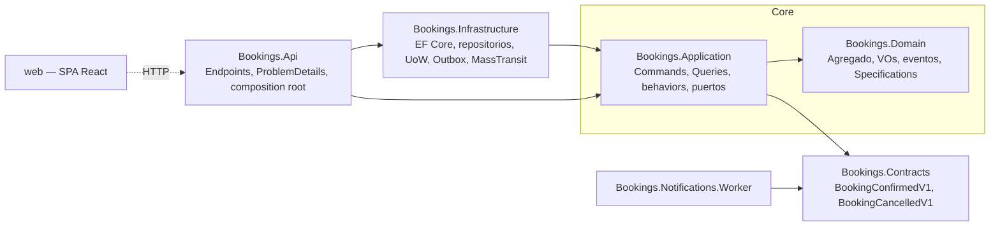
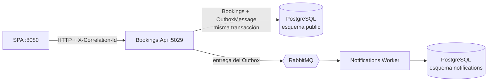
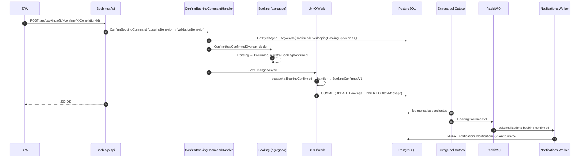

# Bookings — micro-MVP de reservas de recursos

Backend .NET 8 con **arquitectura hexagonal**, **DDD táctico**, **CQRS + Mediator**, **Repository + Unit of Work**, **Specification**, **eventos con Transactional Outbox y RabbitMQ**, un **Worker** de notificaciones independiente y una **SPA en React**.

## Arranque rápido

Requisitos: **Docker** (con Docker Compose). Para desarrollo y tests además: **.NET 8 SDK** (8.0.203 o superior, ver `global.json`) y **Node 20 LTS**.

```bash
docker compose up -d --build
```

| Servicio | URL |
|---|---|
| SPA | http://localhost:8080 |
| API + Swagger | http://localhost:5029/swagger |
| Health checks | http://localhost:5029/health |
| RabbitMQ (management) | http://localhost:15672 — usuario/contraseña `bookings` |
| PostgreSQL | `localhost:5432` — base de datos, usuario y contraseña `bookings` |

Al arrancar, la API **aplica las migraciones** y, si la base de datos está vacía, crea **datos semilla** (el Worker migra su propio esquema). Para empezar de cero: `docker compose down -v`.

### Datos semilla y recorrido guiado

Las fechas son relativas a "mañana", así que siempre están en el futuro.

| Recurso | Reservas | Para probar |
|---|---|---|
| `Room-A` | Ana **Confirmed** 10:00–11:00 · Bruno *Pending* 10:30–11:30 · Carla *Pending* 11:00–12:00 (UTC) | **CA3**: confirmar Bruno → 409 `booking.overlap` y el estado no cambia. **CA4**: confirmar Carla → 200 (intervalos adyacentes) |
| `Room-B` | Diego *Confirmed*, Elena *Pending*, Fran *Cancelled* | **CA5**: cancelar Fran → 422 `booking.invalid_transition` |
| `Desk-12` | 6 reservas *Pending* | Paginación (10 por página en la SPA) |

Tras confirmar o cancelar, el Worker registra la notificación (logs JSON de `bookings-worker` y tabla `notifications."Notifications"`).

`src/Bookings.Api/Bookings.Api.http` contiene además los escenarios CA1–CA5 y CA9 y los casos de F2–F5, ejecutables en orden desde Visual Studio (17.12+), Rider o VS Code (REST Client).

## Tests

```bash
dotnet test                       # dominio, aplicación e integración (requiere Docker: Testcontainers)
cd web && npm ci && npm test      # GenericTable (Vitest + Testing Library)
```

| Proyecto | Qué cubre |
|---|---|
| `Bookings.Domain.Tests` | Transiciones válidas e inválidas, `DateRange`, casos límite de solape (incluida la adyacencia) y la Specification |
| `Bookings.Application.Tests` | `ConfirmBookingCommandHandler` con y sin solape, `ValidationBehavior` |
| `Bookings.Api.IntegrationTests` | `WebApplicationFactory` + PostgreSQL real (Testcontainers) + test harness de MassTransit **con el Outbox activo**: confirma una reserva y verifica que se publica `BookingConfirmedV1` con el `CorrelationId` de la petición |
| `web` | `GenericTable`: cabecera y filas, texto vacío, click y Enter emiten el item |

## Desarrollo local sin contenedores de aplicación

```bash
docker compose up -d bookings-db bookings-broker
dotnet tool restore
dotnet ef database update --project src/Bookings.Infrastructure --startup-project src/Bookings.Api
DOTNET_ENVIRONMENT=Development dotnet ef database update --project src/Bookings.Notifications.Worker
dotnet run --project src/Bookings.Api --launch-profile http          # http://localhost:5029
dotnet run --project src/Bookings.Notifications.Worker
cd web && npm ci && npm run dev                                       # http://localhost:5173
```

## Arquitectura

Las dependencias apuntan siempre hacia el dominio. `Bookings.Contracts` es el lenguaje publicado del contexto: el Worker depende **solo** de él.



En ejecución:



### Flujo al confirmar una reserva



Si RabbitMQ está caído la confirmación responde 200 igualmente: el mensaje espera en `OutboxMessage` y se entrega al volver el broker (CA10).

### Topología de RabbitMQ

MassTransit crea la topología por convención:

| Exchange (fanout) | Cola del Worker | Cola de error (DLQ) |
|---|---|---|
| `Bookings.Contracts:BookingConfirmedV1` | `notifications-booking-confirmed` | `notifications-booking-confirmed_error` |
| `Bookings.Contracts:BookingCancelledV1` | `notifications-booking-cancelled` | `notifications-booking-cancelled_error` |

- La API **publica** en el exchange del contrato; no conoce a los consumidores. Otro servicio podría enlazar su propia cola y recibir su copia.
- El Worker reintenta 3 veces (1 s, 5 s, 15 s). Si sigue fallando, el mensaje va a la cola `_error`; los mensajes que no se pueden deserializar van directamente. Desde la consola se pueden inspeccionar y reenviar.
- **Idempotencia**: el Worker deduplica por `EventId` (comprobación previa + índice único en `notifications.Notifications`), porque la entrega es *al menos una vez* (CA11).

## API

| Endpoint | Respuestas |
|---|---|
| `POST /api/bookings` | 201 + `Location` · 400 |
| `GET /api/bookings?resourceId=&from=&to=&page=&pageSize=&sort=` | 200 `{ items, page, pageSize, totalCount, totalPages }` · 400 |
| `GET /api/bookings/{id}` | 200 · 404 |
| `POST /api/bookings/{id}/confirm` | 200 · 404 · 409 · 422 |
| `POST /api/bookings/{id}/cancel` (cuerpo opcional `{ "reason": "..." }`) | 200 · 404 · 422 |
| `GET /health` | 200 `Healthy`/`Degraded` · 503 `Unhealthy` |

- `from`/`to` devuelven las reservas que **intersectan** `[from, to)`. `sort`: `start`, `-start`, `createdAt`, `-createdAt`. `pageSize` máximo 100.
- Fechas en ISO 8601 con offset; se persisten en UTC.
- Todos los errores son **ProblemDetails (RFC 7807)** con `code` estable y `correlationId`; los de validación incluyen `errors` por campo en camelCase.

| `code` | HTTP |
|---|---|
| `validation_failed`, `bad_request`, resto de `booking.*` de validación de dominio | 400 |
| `booking.not_found` | 404 |
| `booking.overlap` | 409 |
| `booking.invalid_transition` | 422 |
| `internal_error` | 500 |

`/health` comprueba PostgreSQL y RabbitMQ. RabbitMQ caído se informa como **Degraded** (200): gracias al Outbox la API sigue aceptando confirmaciones.

**CorrelationId**: la API lee `X-Correlation-Id` (o genera uno), lo devuelve en la respuesta, lo añade a los logs (scope), a los ProblemDetails y al evento de integración; el Worker lo pone en el scope de sus logs JSON.

## Frontal: React

**Variante elegida: React 18 + Vite**, con React Router, TanStack Query, React Hook Form + Zod y Vitest + Testing Library.

**Justificación.** La variante no venía marcada. Sin experiencia previa en ninguno de los dos frameworks, elegí la opción con menos superficie para el alcance (tres vistas): el componente central, `GenericTable<T>`, es en React una función genérica tipada con `renderRow` (en Angular requiere proyección de contenido con `ng-template`), el enunciado ya proponía el ecosistema completo de React y Vitest permite tener los tests de la tabla con muy poca configuración. Angular habría aportado inyección de dependencias e interceptores nativos, más familiares viniendo de .NET, y su estructura compensa en frontales grandes; para este tamaño y plazo, React tenía menos riesgo.

```
web/src/
  api/                 capa de datos: el único sitio que usa fetch
    httpClient.ts        URL base por entorno (VITE_API_BASE_URL), ProblemDetails → ApiError
    problemDetails.ts    mensaje legible por code + errores por campo
    bookingsApi.ts       DTOs tipados y llamadas
  components/          componentes reutilizables sin conocimiento del dominio
    GenericTable.tsx     (+ GenericTable.test.tsx)
    ErrorAlert.tsx       presentación centralizada de errores
    StatusBadge.tsx
  features/bookings/   vistas del dominio
    hooks.ts             TanStack Query
    BookingsListPage.tsx     /bookings — filtros en la URL, orden y paginación
    BookingDetailsPage.tsx   /bookings/:id — detalle y acciones según el estado
    BookingFormPage.tsx      /bookings/new — validación cliente + errores del servidor por campo
    bookingSchema.ts         reglas Zod equivalentes a las del servidor
```

- TypeScript `strict`. Estados de carga, vacío y error en todas las vistas.
- Si una acción falla (p. ej. 409 al confirmar), se muestra el error y el estado no cambia: la caché solo se invalida si la mutación tiene éxito (CA8).
- En Docker, `VITE_API_BASE_URL` se fija al construir la imagen (Vite la incrusta en el bundle) y apunta al puerto publicado de la API, porque las llamadas las hace el navegador.

## Estructura del repositorio

```
src/
  Bookings.Domain/                 agregado Booking, VOs, eventos, Specifications
  Bookings.Application/            commands, queries, handlers, puertos, behaviors
  Bookings.Contracts/              eventos de integración V1
  Bookings.Infrastructure/         EF Core, repositorio, queries, UoW, Outbox, MassTransit, health checks, seed
  Bookings.Api/                    endpoints, ProblemDetails, CORS, correlación, composition root
  Bookings.Notifications.Worker/   consumidores idempotentes, esquema notifications
web/                               SPA React
tests/                             Domain, Application, Api.IntegrationTests
docs/adr/                          decisiones de arquitectura
docker-compose.yml
```

## Decisiones (ADR)

1. [Validación: FluentValidation y dónde se valida cada cosa](docs/adr/0001-validacion.md)
2. [Elección del mediator](docs/adr/0002-mediator.md)
3. [Modelado del solape y estrategia de concurrencia](docs/adr/0003-solape-y-concurrencia.md)
4. [Outbox, broker e idempotencia del consumidor](docs/adr/0004-outbox-broker-idempotencia.md)
5. [Diseño de la tabla genérica en React](docs/adr/0005-tabla-generica.md)

Otras decisiones relevantes: errores de dominio con **excepciones** y código estable (en lugar de un tipo Result) para no mezclar dos canales de error; DTO único `BookingDto` para listado y detalle (las dos vistas necesitan hoy los mismos datos; se separaría si divergen); dependencias con licencia abierta (MassTransit 8.4.1 en lugar de la v9 comercial; 8.4.1 y no 8.5, que arrastra EF Core 9).

## Qué haría con más tiempo

- **Calidad**: test de concurrencia que lance dos confirmaciones solapadas en paralelo y verifique que la restricción `EXCLUDE` deja pasar solo una; tests de arquitectura (NetArchTest) para las reglas de dependencia; mutation testing (Stryker.NET); tests e2e del frontal (Playwright) y de las vistas.
- **Operación**: OpenTelemetry de API → RabbitMQ → Worker (sustituyendo la correlación manual por W3C Trace Context); migraciones como paso propio del despliegue (script idempotente o bundle) en lugar de al arrancar; `/health/live` y `/health/ready` separados; pipeline de CI.
- **Producto**: actualización en tiempo real del listado y el detalle (SignalR); paginación por cursor si el volumen lo justifica; autenticación (fuera de alcance).
- **Detalles**: traducciones de los mensajes de validación del servidor; Central Package Management para fijar también las dependencias transitivas.

## Uso de herramientas de IA

He usado **Claude (Anthropic)** a lo largo de la prueba:

- **Como tutor y revisor** en la parte central (dominio, casos de uso, persistencia, specifications, concurrencia y eventos): explicaciones de conceptos y alternativas, revisión del código que escribía con recomendaciones y preparación de las preguntas de la entrevista. Ese código lo escribí yo con ejemplos de otro dominio como guía.
- **Generando código bajo mi revisión** cuando el tiempo apretaba: escenarios del fichero `.http`, el SQL de la restricción de exclusión, la traducción de errores en el `UnitOfWork`, el middleware de correlación, el Worker de notificaciones, los health checks y CORS, los tests, el frontal, los Dockerfiles y el compose, el seed y la primera versión de esta documentación y los ADR.
- **Verificación**: todo lo generado se compiló, se ejecutó y se probó de extremo a extremo (incluidos CA3, CA4, CA10, CA11 y CA12 en una copia limpia); además se introdujeron fallos a propósito para comprobar que los tests los detectan.

Cada decisión de este README y de los ADR la he revisado y puedo defenderla.
